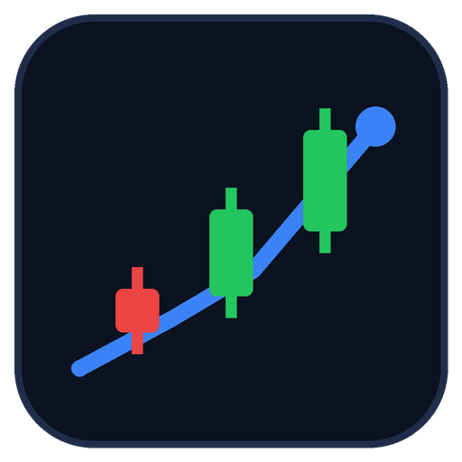

<p align="center">
  
</p>

<h1 align="center">Stock Market Monitoring Dashboard</h1>

<p align="center">Market overview, price performance, and historical trend analysis built with Python, pandas, Plotly and Streamlit.</p>

> **Educational project. Not investment advice.** The bundled dataset is **synthetic demonstration data** (fictional companies, random-walk prices). It is not real market data.

## 1. Project overview

This is a junior data analyst portfolio project. It is a Streamlit dashboard that lets you monitor a stock's price history, compare several stocks, review simple technical indicators, keep a session watchlist and value a hypothetical portfolio. The look is a dark "market terminal" style: navy background, green for gains and red for losses.

It works in two modes:

- **Sample Data:** a reproducible synthetic dataset included in the repository. Works offline.
- **Live Historical Data:** daily history from Yahoo Finance through `yfinance` (needs internet, no API key). If it fails, the app falls back to the sample data.

## 2. Objectives and business questions

- Which stocks gained or lost the most over a chosen period?
- Which stocks were more volatile, and how deep were their drawdowns?
- How do stocks with very different share prices compare on a fair basis?
- What do moving averages, RSI and volatility look like for one stock?
- How does a small, hypothetical set of holdings stand against the latest close?

## 3. Features

- KPI cards: latest close, daily change, daily % change, period return, period high and low, average volume.
- Interactive Plotly price chart (candlestick or line), 20 and 50-day moving averages (window sizes configurable), volume panel, range buttons.
- Comparison of up to five tickers, normalized to 100 at the start.
- Returns analysis: daily-return distribution and cumulative return.
- Indicators: RSI (14), 20-day historical volatility, maximum drawdown, each with a short explanation.
- Session watchlist (add and remove symbols) with latest close, daily change and period return.
- Hypothetical portfolio tracker with cost, market value, unrealized profit or loss, return and allocation.
- Graceful handling of unknown tickers, network failures, rate limits, empty results and missing values.

## 4. Technology stack

Python 3.11+, pandas, NumPy, Plotly, Streamlit, yfinance (optional live data), Jupyter Notebook, Git and GitHub Codespaces. Tests use the standard-library `unittest` module.

## 5. Sample dataset

`data/sample_stock_prices.csv` holds daily records for 10 fictional tickers from 2025-01-02 to 2026-06-30 (about 18 months, 374 trading days each).

| Column | Meaning |
| --- | --- |
| Date | Trading date |
| Ticker, Company | Fictional symbol and company name |
| Open, High, Low, Close | Simulated daily prices |
| Adjusted_Close | Close adjusted for simulated quarterly dividends |
| Volume | Simulated shares traded |

The generator (`scripts/generate_sample_data.py`) uses a fixed seed (42). Each stock has its own drift, volatility, market sensitivity and volume level, and all stocks share a simulated sell-off and rebound. More detail is in [data/README.md](data/README.md).

## 6. Synthetic versus live data

| | Sample Data | Live Historical Data |
| --- | --- | --- |
| Source | Generated by `scripts/generate_sample_data.py` | Yahoo Finance via `yfinance` |
| Companies | Fictional | Real |
| Needs internet | No | Yes |
| Labeled in the app | "SAMPLE DATA · SYNTHETIC" banner | Ticker, period and retrieval time shown |
| Real quotes | Never | Historical daily bars, not a guaranteed real-time feed |

The app always shows which source is active. Live data is described by its latest available date and retrieval time, not as a real-time quote. Supported live periods: 1 month, 3 months, 6 months, 1 year, 2 years and 5 years.

## 7. Technical indicator definitions

All formulas are implemented in [src/market_analysis.py](src/market_analysis.py) with pandas and NumPy.

| Indicator | Definition | Edge cases |
| --- | --- | --- |
| Daily return | `Close(t) / Close(t-1) - 1` | First row is NaN; a zero previous close gives NaN |
| Moving average (20 and 50 day) | Mean of the last N closes | NaN until N observations exist |
| RSI (14) | `100 - 100 / (1 + avg gain / avg loss)` with Wilder's smoothing | NaN until 15 observations; no losses gives 100 (or 50 if the price never moved) |
| Historical volatility (20 day) | Sample standard deviation of the last 20 daily returns, times √252 to annualize | NaN until 21 observations |
| Maximum drawdown | Largest fall from a running peak close to a later trough close | NaN for an empty series |
| Normalized performance | Each close divided by its first close on the first common date, times 100 | Only dates where all selected tickers have data are used |

Moving averages describe past prices and are not predictions. The RSI reference levels of 30 and 70 are conventions, not automatic buy or sell signals.

## 8. Watchlist and portfolio features

**Watchlist:** add or remove symbols in the sidebar. The list lives in the Streamlit session and is kept separately for each data source so real and fictional tickers never mix. In sample mode, a real ticker such as AAPL is shown as unavailable (no invented prices); switch to Live Historical Data to use it.

**Portfolio:** enter hypothetical holdings (ticker, shares, purchase price per share). The app calculates total purchase cost, latest market value, unrealized profit or loss, unrealized return and allocation. Holdings without price data are shown as unavailable. Calculations exclude fees, taxes, dividends and other costs, and nothing is stored outside the session.

## 9. Dashboard preview

No screenshot is bundled because this repository was assembled in an environment that could not launch the app. To add a genuine preview:

1. Run the dashboard (see below) and take a screenshot.
2. Save it as `assets/dashboard_preview.png`.
3. Add `` to this section.

## 10. Findings from the sample data

These numbers describe the **synthetic** dataset only. They come from the generator's settings and say nothing about real companies. They can be reproduced in [notebooks/stock_market_analysis.ipynb](notebooks/stock_market_analysis.ipynb).

| Ticker | Company (fictional) | Total return | Annualized volatility | Max drawdown | Avg daily volume |
| --- | --- | ---: | ---: | ---: | ---: |
| ARCD | Arcadia Software | +94.3% | 29.9% | -36.9% | 12.8M |
| LYRA | Lyra Media Networks | +86.8% | 49.2% | -41.9% | 12.0M |
| HBRN | Harborne Financial | +59.0% | 24.9% | -25.1% | 16.5M |
| BLWK | Bluewick Retail Group | +19.9% | 23.8% | -26.1% | 9.6M |
| CRST | Crestline Energy | +4.9% | 35.4% | -40.9% | 11.2M |
| GLDW | Goldwater Utilities | -2.4% | 12.7% | -18.9% | 4.4M |
| FRGE | Forgeline Industrials | -8.5% | 19.7% | -31.5% | 3.5M |
| NVLX | Novalux Semiconductors | -15.2% | 44.4% | -42.4% | 29.3M |
| KMTO | Kometo Telecom | -19.9% | 20.6% | -36.2% | 19.1M |
| DLTN | Deltaon Biotech | -28.4% | 67.5% | -58.6% | 20.3M |

- Period: 2025-01-02 to 2026-06-30 (374 trading days, 10 fictional tickers).
- 5 of 10 synthetic stocks ended the period higher. The best performer was **ARCD** (+94.3%) and the weakest was **DLTN** (-28.4%).
- **DLTN** was the most volatile (67.5% annualized) and **GLDW** the least (12.7%). These differences were set on purpose in the generator.
- Deepest maximum drawdown: **DLTN** (-58.6%). Shallowest: **GLDW** (-18.9%).
- Highest average volume: **NVLX** (29.3M shares per day).
- Absolute daily returns and volume were positively correlated for every ticker (median 0.63). That is built into the generator, which raises volume on larger moves, so it is not a market discovery.

## 11. Project structure

```text
stock-market-monitoring-dashboard/
├── app.py                          # Streamlit dashboard
├── README.md
├── requirements.txt
├── LICENSE
├── .gitignore
├── .devcontainer/devcontainer.json # GitHub Codespaces setup
├── .streamlit/config.toml          # Dark theme colors
├── assets/
│   ├── market_logo.svg
│   └── market_logo.png
├── data/
│   ├── sample_stock_prices.csv     # synthetic demonstration data
│   └── README.md
├── notebooks/stock_market_analysis.ipynb
├── scripts/generate_sample_data.py
├── src/
│   ├── __init__.py
│   └── market_analysis.py          # reusable calculations
└── tests/test_market_analysis.py
```

## 12. Installation (any computer)

Requires Python 3.10 or newer.

```bash
python -m pip install -r requirements.txt
streamlit run app.py
```

Then open the local URL Streamlit prints (usually http://localhost:8501).

## 13. GitHub Codespaces

1. Upload this project to a GitHub repository.
2. Click **Code → Codespaces → Create codespace on main**. The `.devcontainer` configuration installs the dependencies automatically (this takes a minute or two).
3. In the Codespaces terminal run:

   ```bash
   streamlit run app.py
   ```

4. Codespaces forwards port 8501 automatically. Click **Open in Browser** in the pop-up, or open the **Ports** tab, find port 8501 and click the globe icon.

If the port is private and the page does not load, right-click the port in the **Ports** tab and set its visibility, or use the forwarded address shown there.

## 14. Windows local setup

In PowerShell, from the project folder:

```powershell
python -m venv .venv
.venv\Scripts\Activate.ps1
python -m pip install -r requirements.txt
streamlit run app.py
```

If PowerShell blocks the activation script, run `Set-ExecutionPolicy -Scope Process RemoteSigned` first, or use Command Prompt and `.venv\Scripts\activate.bat`.

## 15. Running the Jupyter notebook

```bash
python -m jupyter notebook notebooks/stock_market_analysis.ipynb
```

In Codespaces or VS Code, open the notebook file and choose the Python kernel. Run the cells from top to bottom. The notebook imports the same functions from `src/market_analysis.py` that the dashboard uses.

## 16. Regenerating the sample data

```bash
python scripts/generate_sample_data.py
```

The output is identical on every run (fixed seed). Edit the `COMPANIES` list or `SEED` in the script to experiment.

## 17. Running the tests

```bash
python -m unittest discover -s tests -v
```

The tests check the CSV, OHLC rules, indicator math, KPIs, portfolio math and live-data error handling. Live-data tests use a fake fetcher, so they need no internet.

## 18. Live-data limitations and attribution

- Live data comes from Yahoo Finance through the open-source `yfinance` library. This project is not affiliated with or endorsed by Yahoo.
- Availability, accuracy, delays and licensing can vary. Yahoo Finance data access is subject to Yahoo's applicable terms; check them before using the data beyond personal learning.
- Data is daily history. It is not a real-time feed, and the app does not claim otherwise.
- Requests can fail because of network problems, unknown symbols or rate limits. The app shows a message and falls back to the sample data. Live results are cached for 15 minutes; use **Refresh live data** to reload.
- Charts use unadjusted closing prices. Splits and dividends are not modeled in the calculations.

## 19. Known limitations and future improvements

- The sample data is random, so it has no real-world events, earnings or news.
- Weekends are skipped on charts, but exchange holidays can still appear as small gaps.
- The watchlist and portfolio reset when the browser session ends.
- Indicators are limited to a small, explainable set.
- Ideas: export tables to CSV, more indicators such as MACD, benchmark comparison, adjusted-price returns, more tests for the Streamlit layer.

## 20. Disclaimer

This project is for education and portfolio demonstration only. It is **not investment advice**, a recommendation, or an offer to buy or sell any security. Technical indicators are historical calculations, not predictions or trading signals. Sample data is synthetic and does not represent real prices.

## License

Released under the [MIT License](LICENSE).
